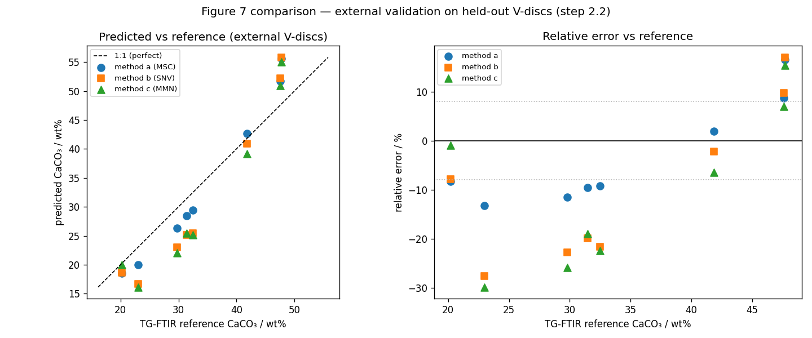

# carbonate-cement-PLS

> 🚧 **Work in progress.** This repo does not yet reproduce the paper. The preprocessing recipe is still open (see below).

Can open-source Python (scikit-learn PLS) replace Bruker's commercial OPUS Quant 2
for quantifying CaCO₃ in carbonated cement paste from ATR-IR spectra, at the
published accuracy?

The method and data come from the open-access paper (user is first author):
Kalkreuth et al., "Accelerated carbonation of hardened cement paste: Quantification
of calcium carbonate via ATR infrared spectroscopy", *J. Am. Ceram. Soc.* 2023,
[doi:10.1111/jace.19546](https://doi.org/10.1111/jace.19546).

## What is built (phases 0–2)

- **OPUS loader:** reads the absorbance block of Bruker OPUS files and groups replicates.
- **Labels:** TG-FTIR CaCO₃ wt% per sample, extracted from the lab Excel into `data/labels.csv` and `data/val_labels.csv`.
- **Dataset:** replicates averaged to one row per sample; 12 calibration samples, 2.45–61.26 wt% CaCO₃.
- **Preprocessing toolkit:** SNV, MSC, MMN, SLS, LOS, Savitzky-Golay 1st derivative and spectral windows, as sklearn transformers.
- **PLS + leave-one-out CV:** R², RMSECV and a factor sweep.
- **Methods a/b/c:** each method searches the preprocessings that the paper's Table 3 lists and keeps the lowest-RMSECV one.
- **External validation:** fit on all 12 calibration samples, predict the paper's 8 Figure-7 points (20.2–47.7 wt%).

## Current results (provisional)

These numbers come from `reports/1.3_table3.md` and `reports/2.2_figure7.md`.
They use the provisional recipe described in the next section.

| Method | Window / cm⁻¹ | Selected | Factors | R² ours / paper (%) | RMSECV ours / paper (wt%) | RMSEP (wt%) | t-test p ours / paper |
|---|---|---|---|---|---|---|---|
| a | 683–1620 | MSC | 4 | 99.47 / 99.52 | 1.36 / 1.38 | 3.90 | 0.914 / 0.526 |
| b | 652–1266 & 3013–3683 | SNV | 4 | 99.85 / 99.62 | 0.72 / 1.10 | 5.75 | 0.355 / 0.241 |
| c | 652–1266 | MMN | 3 | 99.37 / 99.47 | 1.48 / 1.34 | 5.78 | 0.243 / 0.730 |

- Calibration RMSECV lands within ±0.3 wt% of the paper for a and c. Method b is 0.38 wt% better than the paper.
- On external validation, errors grow: RMSEP is 3.9–5.8 wt%.
- The paper reports relative errors of ≤ 8–9% for a and c, excluding references above 47 wt%. Ours reach 13.2% (a) and 29.8% (c).
- All three paired t-tests give p > 0.05, as in the paper. This check also passes for recipes known to be wrong, so it does not confirm the recipe.



## Open question: the preprocessing recipe

Table 3 lists four preprocessings per method. The current code treats them as a
menu and picks one, so no model uses the derivative. The OPUS model files and lab
notes imply a derivative plus a scatter correction. The order of those steps and
the meaning of "1.DER+SLS" are unresolved, so the numbers above are provisional.

## Caveats

- **Small n.** 12 calibration samples and 8 validation points. Leave-one-out CV at this size is optimistic.
- **Selection bias.** Preprocessing is selected on the same leave-one-out CV it is reported on, as OPUS does.
- **Closed algorithms.** OPUS's SLS, LOS and MMN are not published. The versions here are best-effort.
- **Labels taken as given.** The TG-FTIR reference values are consumed, not re-derived.

## Tests

`pytest` runs 11 tests on every push via GitHub Actions (Python 3.11):

- **Pinned data:** `labels.csv` matches the reference values in the OPUS model files; the validation set has the 8 Figure-7 points.
- **Leakage:** no validation file or row reaches calibration fitting.
- **Figure-7 grouping:** each validation file maps to exactly one Figure-7 point.

## Next steps

- **2.3 (optional):** the paper's Stage-3 augmentation, with a critique of mixing validation into calibration.
- **Phase 3:** univariate band-area baseline, PLS coefficient interpretation, replicate-level leakage demo, a light preprocessing/window search, PLS vs PCR/Ridge.
- **Phase 4:** consolidate the package, a CLI to predict CaCO₃ from a new spectrum, a narrative notebook.

The plan lives in `SPEC.md` and `design-tree.md`.

## Run it

```bash
pip install -r requirements-lock.txt   # exact versions, as in CI (Python 3.11)
python scripts/reproduce_table3.py     # writes reports/1.3_table3.md
python scripts/reproduce_figure7.py    # writes reports/2.2_figure7.md and .png
pytest
```

Both scripts run from the committed data. Only the label builders
(`scripts/extract_*labels.py`) need the lab Excel, which is kept local.

## Layout

| Path | What |
|------|------|
| `src/` | OPUS loader, dataset assembly, preprocessing, PLS + CV, methods a/b/c, validation |
| `scripts/` | label builders (need the local Excel), sanity-check plots, Table 3 and Figure 7 runners |
| `tests/` | pytest tests: pinned data, leakage, Figure-7 grouping |
| `notebooks/` | empty for now; a narrative walkthrough is planned |
| `reports/` | committed result tables; `reports/figures/` holds the README figure (other plots are regenerated locally, gitignored) |
| `models/` | empty; reserved for trained models (gitignored) |
| `data/` | 36 calibration + 63 validation OPUS spectra, `labels.csv`, `val_labels.csv` (lab Excel kept local) |
| `.github/workflows/` | CI: installs the lock file and runs pytest |

## License and citation

Code: [MIT](LICENSE). Spectral data under `data/`: [CC-BY-4.0](LICENSE-DATA).
If you use the data, cite Kalkreuth et al., *J. Am. Ceram. Soc.* 2023,
[doi:10.1111/jace.19546](https://doi.org/10.1111/jace.19546).
